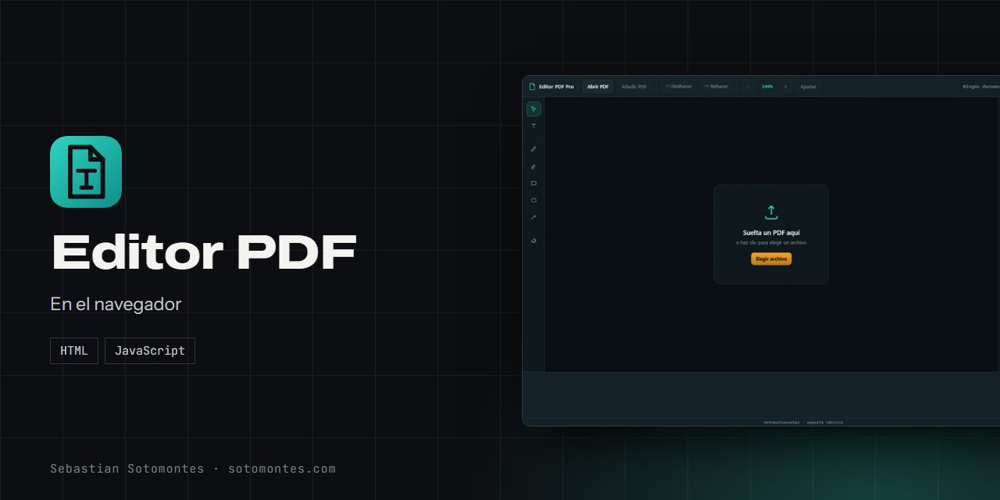
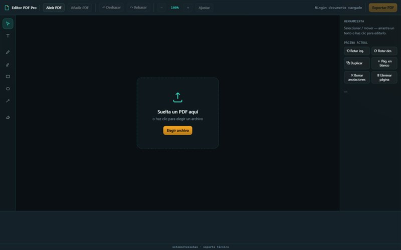
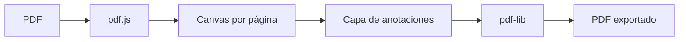

Anota, agrega texto y formas, rota o reordena páginas y exporta. El documento nunca sale de tu equipo.

<a href="https://sotomontes.com/#editor-pdf"><b>Ver en sotomontes.com</b></a> · <a href="#cómo-se-usa">Cómo se usa</a> · <a href="#cómo-funciona-por-dentro">Cómo funciona</a> · <a href="#novedades">Novedades</a>

| Ficha técnica | |
|---|---|
| **Autor** | Sebastian Sotomontes |
| **Tipo** | En el navegador |
| **Plataforma** | Navegador web, sin instalación |
| **Versión** | 1.0 |
| **Estado** | Funcional |
| **Stack** | HTML · JavaScript |
| **Código** | Privado. Esta página es solo una presentación. |

---

## Qué es

Editor PDF es un editor ligero que corre por completo en el navegador. Sirve para anotar y arreglar un documento rápido, sin instalar nada y sin subirlo a ningún sitio. Las anotaciones se escriben de verdad dentro del PDF al exportar.

## Novedades

- Combinar documentos y exportar anotaciones dentro del PDF.

## Cómo se usa

1. Abre la herramienta y suelta un PDF, o pulsa **Elegir archivo**.
2. Usa **Añadir PDF** si quieres combinar otro documento.
3. Elige una herramienta de la barra izquierda: texto, lápiz, resaltador, rectángulo, elipse, flecha o borrador.
4. En el panel derecho rota, duplica, inserta o elimina páginas.
5. Pulsa **Exportar PDF** para descargar el resultado.

## Funciones

- **Abrir y combinar** archivos PDF.
- **Herramientas**: texto, lápiz, resaltador, formas, flechas y borrador.
- **Páginas**: rotar, duplicar, insertar y eliminar.
- **Sin servidor**: el documento no sale de tu navegador.

## Detalles

- Zoom, deshacer y rehacer.
- Arrastra un texto para moverlo o haz clic para editarlo.

## Privacidad y seguridad

El PDF se abre, se edita y se exporta en tu navegador, sin enviarse a ningún lado.

## Cómo funciona por dentro

### Flujo

### Cómo funciona

El PDF se **dibuja** página por página con **pdf.js** sobre un `<canvas>`, y encima va una capa donde pintas tus
anotaciones (texto, trazos, formas). Al exportar, esas anotaciones se **escriben de verdad** dentro del PDF con
**pdf-lib**, que también maneja rotar, duplicar, insertar y borrar páginas. El archivo se procesa completo en memoria;
no hay subida ni servidor.

### Tecnologías

| Pieza | Para qué |
|---|---|
| **pdf.js** | Renderizar el PDF a `<canvas>` para verlo y anotarlo. |
| **pdf-lib** | Escribir las anotaciones y modificar páginas en el PDF de salida. |
| **HTML + CSS + JS** | Interfaz y capa de anotación, en un solo archivo. |

**Créditos:** usa pdf.js y pdf-lib.

---

© 2026 Sebastian Sotomontes. Todos los derechos reservados.
